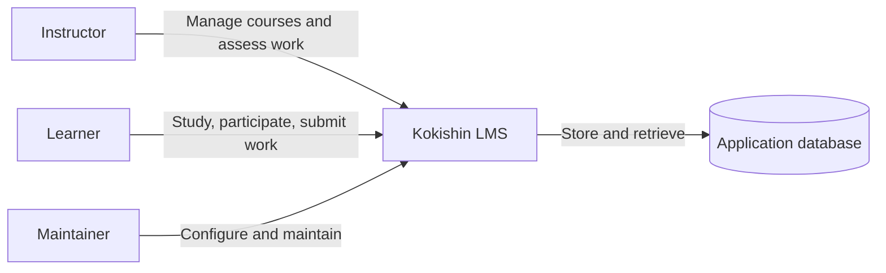

# System Context

## Purpose

This document defines Kokishin's external actors and the system boundary at a conceptual level.

## Actors

- **Instructor:** creates courses and learning content, publishes announcements, manages assignments, reviews submissions, and provides feedback.
- **Learner:** accesses enrolled courses, reads course material, participates in activities, submits assignments, and reviews feedback.
- **Maintainer:** configures, operates, and updates the application.

## System boundary

Kokishin contains the web interface, application behavior, and persistent course data. External identity providers, institutional systems, email delivery services, and file-storage providers are not required for the first MVP unless later requirements explicitly add them.

## Context diagram

## Key boundaries

- The server is responsible for authentication checks, authorization, validation, and business rules.
- The database stores persistent application data.
- The browser presents the interface but is not a trusted enforcement boundary.
- Future external integrations should be introduced only with a defined use case and decision.
