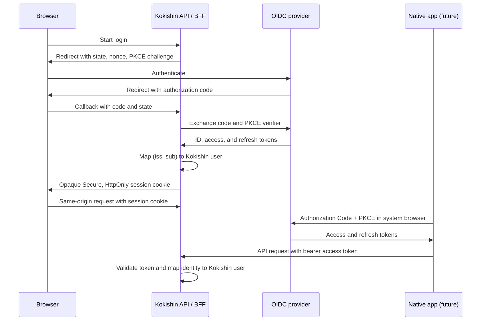

# AD-006: Authentication architecture

**Status:** Accepted

## Context

Kokishin is a .NET 10 API with a React and TypeScript web client planned. The
MVP needs instructor and learner accounts; responsive web use is in scope, while
native mobile applications are not. Production is home-hosted, SQLite is the
current persistence foundation, and no authentication implementation or
identity-provider dependency exists yet. The server must enforce authentication
and authorization, and credentials and secrets must not be committed
([requirements](../goals/requirements.md),
[system context](../architecture/system-context.md),
[MVP scope](../goals/mvp-scope.md)).

The approach must support web and future native clients without making Kokishin
responsible for storing passwords, issuing interoperable tokens, and building a
password-recovery system. Home hosting makes the identity service's availability,
updates, backup, email delivery, and secure configuration operational
responsibilities rather than assumed cloud services.

## Decision

Use Authentik as the separately operated, self-hosted identity provider. It
supports the selected OpenID Connect (OIDC) and OAuth 2.0 protocol and client
behavior described by this decision.

- **Browser:** Use the API as a same-origin backend-for-frontend (BFF) and
  confidential OIDC client with Authorization Code and PKCE. Keep provider
  tokens in protected server-side session storage and give the browser only an
  opaque session cookie marked `Secure`, `HttpOnly`, and appropriately
  `SameSite`. Protect cookie-authenticated state-changing requests against CSRF.
- **Native mobile, if added:** Use the system browser with Authorization Code
  and PKCE as a public client. Send short-lived access tokens to the API as
  bearer tokens and keep rotating refresh tokens only in the platform's secure
  storage. Do not embed a client secret in a mobile application.
- **API:** Validate mobile access-token signature, issuer, audience, and
  expiration against the configured OIDC authority and signing keys. Authenticate
  browser requests through the BFF session. Both paths resolve to the same
  Kokishin user and are subject to server-side authorization.
- **Identity mapping:** Use the pair `(issuer, subject)` (`iss`, `sub`) as the
  external identity key and map it to a stable, internal Kokishin user ID.
  Email is a profile/contact attribute, not an identifier; never silently link
  identities by matching email addresses. Create or link an application user
  only through an explicit, verified provisioning flow. Keep instructor/learner
  roles, enrollments, and course permissions under Kokishin's control rather
  than trusting client-supplied role claims.
- **Credential and account lifecycle:** The provider owns primary credentials,
  password policy, MFA policy, verification, and account recovery. Recovery
  uses a verified address and a short-lived, single-use reset flow with
  rate-limiting and responses that do not disclose whether an account exists.
  Kokishin controls account provisioning, disablement, and authorization.
  Initial account creation should be invite- or maintainer-controlled, not
  unrestricted public registration.
- **Session and token lifecycle:** Start with 10-minute access tokens, rotating
  refresh tokens with a 30-day maximum lifetime, and browser sessions with a
  30-minute idle timeout and 7-day absolute lifetime; make these policies
  configurable. Detect refresh-token reuse and revoke the token family. Logout
  clears the browser session or native local tokens and requests provider
  session termination through OIDC RP-Initiated Logout and refresh-token
  revocation. Already-issued access tokens can remain valid until expiry;
  disabling an account must also block its application access, and signing-key
  rotation is the emergency invalidate-all mechanism. Do not claim immediate
  revocation of a self-contained access token.

### Authentication flow

### API integration

The API uses ASP.NET Core OpenID Connect and bearer authentication handlers.
The confidential web client uses Authorization Code with PKCE and stores its
provider tokens in a protected server-side ticket; the browser receives only an
opaque secure, HTTP-only cookie. Cookie-authenticated state-changing requests
require an antiforgery request token. Native bearer tokens use OIDC discovery
and signing keys and are validated for issuer, audience, signature, and
lifetime. The API maps the validated `(issuer, subject)` pair to a stable,
deterministic internal Kokishin identifier and does not use email or
provider-specific subject values as application user IDs.

The current session ticket store is in-process memory, so a restart invalidates
browser sessions and multiple API instances do not share them. Deployments
requiring persistence or multiple instances must supply a shared protected
ticket store and persist Data Protection keys. This integration does not
provision accounts or grant roles; application account provisioning and
authorization remain server-controlled.

## Alternatives considered

| Approach | Benefits | Reasons not selected |
| --- | --- | --- |
| Kokishin-managed passwords with ASP.NET Core Identity and cookies | Integrates naturally with ASP.NET Core and is straightforward for a browser-only MVP. | Kokishin would own password security, recovery email, MFA, session management, and account-security operations. Native clients would still need a separately designed token protocol and lifecycle. |
| Managed third-party OIDC provider | Reduces identity-service operations and provides established account security and recovery capabilities. | Adds a production SaaS, availability, cost, and data-processing dependency that does not fit the current home-hosted/no-provider assumption. Reconsider if operating a self-hosted provider is not sustainable. |
| Authentik (selected self-hosted OIDC provider) | Standard client and API protocols support the browser now and native clients later; credentials and recovery remain outside Kokishin's domain and database. | Requires operating and backing up another security-critical service and its email/configuration dependencies. |
| API-minted bearer tokens without an OIDC authority | Gives Kokishin direct control over client token behavior. | Makes Kokishin responsible for secure credential handling, token issuance, refresh/revocation, and recovery while creating a custom identity protocol. |

## Consequences and implementation guidance

- The provider must support OIDC discovery and signing keys, Authorization Code
  with PKCE using `S256`, separate confidential and public clients, refresh-token
  rotation and OAuth token revocation, OIDC RP-Initiated Logout, and account
  verification/recovery. MFA support is required before exposing accounts
  beyond a trusted MVP.
- Keep provider protocol and BFF composition in the API boundary. Application
  should own use-case abstractions and account provisioning rules; Domain stays
  independent of OIDC and Infrastructure. Preserve the existing project
  references in the root [README](../../README.md#solution-structure).
- In Development, use a local, non-production provider configuration and
  separate client/realm, local HTTPS, and .NET User Secrets for any confidential
  client secret. Do not use real user credentials or commit secrets to
  `appsettings*.json`.
- In Production, terminate public traffic over HTTPS. Supply the confidential
  client secret, provider administration/bootstrap credentials, email-delivery
  credentials, and any encryption keys from deployment-managed secret storage
  (or restricted host-provided secrets), never source control or checked-in
  settings. Rotate them and restrict access. Persist and protect provider
  signing keys, BFF session data, and ASP.NET Core Data Protection keys across
  restarts; include them and the provider's user/configuration data in protected
  backups and recovery tests. Keep issuer, audience, client IDs, and callback
  URLs as non-secret environment-specific configuration.
- The home-hosted deployment must monitor provider and API availability, apply
  security updates, preserve TLS and callback configuration, and test restoration.
  If these obligations are not supportable, revisit the managed-provider
  alternative before implementation.
- Authentication does not itself grant course access. Every protected operation
  must enforce the internal user's status, role, enrollment, and applicable
  course permissions on the server.
