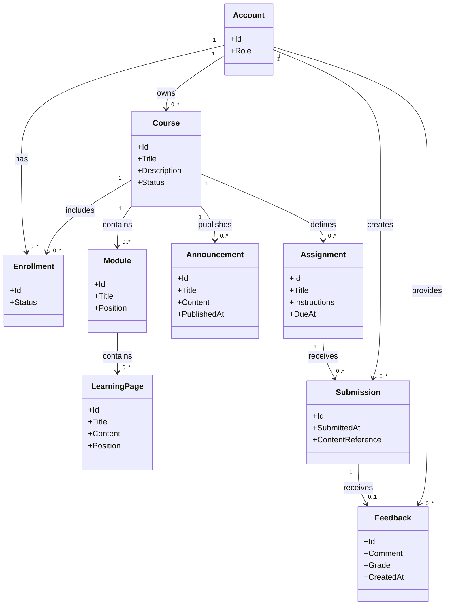

# Class Diagram

This conceptual domain model identifies likely core entities. Names, relationships, and fields may change during detailed design.

## Notes

- This is a conceptual model, not a final database schema.
- `Account.Role` is the account-level instructor/learner role; enrollment does
  not assign roles or represent course ownership. Only Learner accounts may be
  enrolled.
- `Enrollment.Status` is `Active`, `Suspended`, `Withdrawn`, or `Removed`.
  Course owners manage enrollment, and learners may withdraw their own
  enrollment. See [AD-008](../decisions/AD-008-course-enrollment.md) for the
  complete lifecycle and course-access rules.
- Authentication details, file storage, discussion threads, rubrics, quizzes, and audit fields need further specification before implementation.
