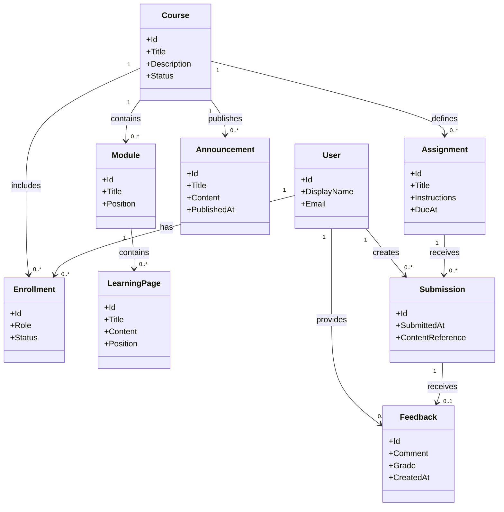

# Class Diagram

This conceptual domain model identifies likely core entities. Names, relationships, and fields may change during detailed design.

## Notes

- This is a conceptual model, not a final database schema.
- Authentication details, file storage, discussion threads, rubrics, quizzes, and audit fields need further specification before implementation.
