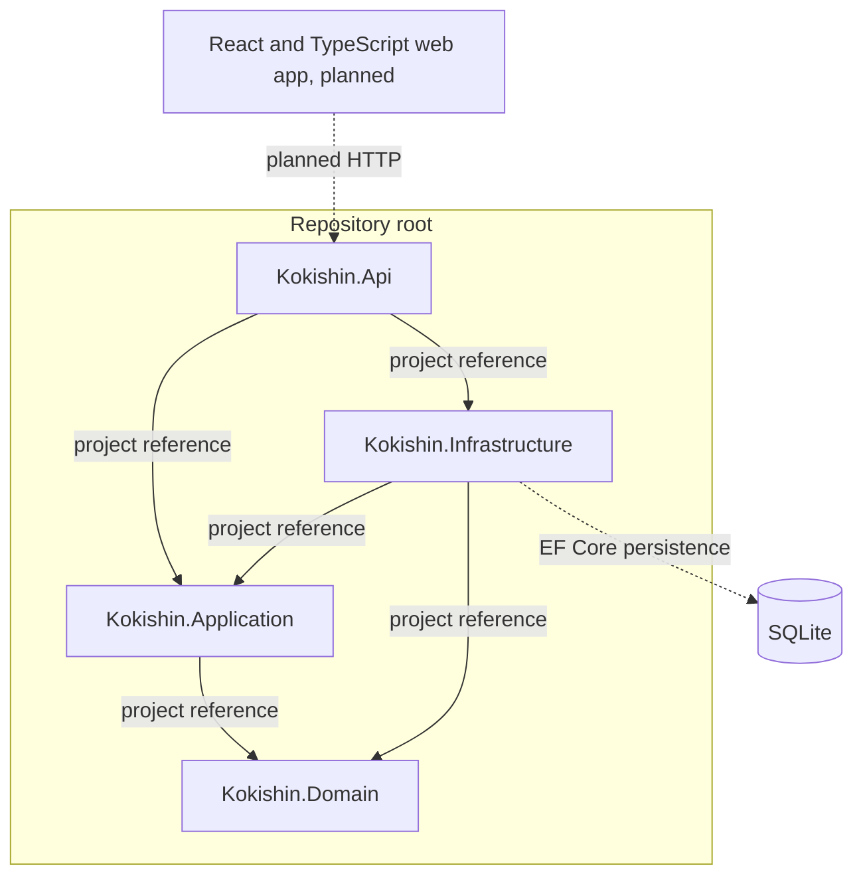

# Component Diagram

Solid arrows show current project references. Dashed arrows show external
runtime integrations. The backend projects, dependency-injection registrations,
and SQLite persistence exist, but product endpoints are not implemented yet.

## Responsibilities

- **Web app:** displays navigation, course content, forms, submissions, grades, and feedback.
- **API (`Kokishin.Api`):** HTTP host and composition root. Product endpoints, request validation, and authorization will be added with their features.
- **Application (`Kokishin.Application`):** coordinates use cases and may own abstractions required from infrastructure.
- **Domain:** owns core concepts and business rules.
- **Infrastructure (`Kokishin.Infrastructure`):** implements application abstractions and handles persistence and other external technical details.
- **Database:** local SQLite persistence is configured in Infrastructure; the initial migration is an empty baseline.

The project references enforce the dependency direction: Domain has no project
references; Application references only Domain; Infrastructure references
Application and Domain; API references Application and Infrastructure. The API
composes Infrastructure through dependency injection. Application does not
depend on Infrastructure. The solution and all project directories are located
at the repository root; see the [README](../../README.md#solution-structure).
