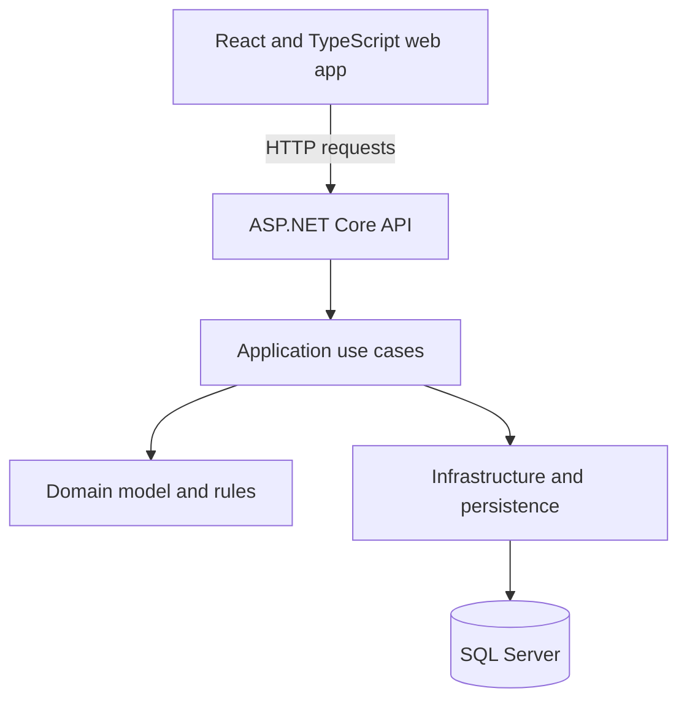

# Component Diagram

The diagram shows the intended high-level separation of responsibilities.

## Responsibilities

- **Web app:** displays navigation, course content, forms, submissions, grades, and feedback.
- **API:** exposes endpoints, validates requests, applies authorization, and returns responses.
- **Application:** coordinates use cases such as creating a course or reviewing a submission.
- **Domain:** owns core concepts and business rules.
- **Infrastructure:** implements persistence and other external technical details.
- **Database:** stores durable application data.

This is a logical component view. Physical project boundaries and deployment details will be finalized when implementation begins.
