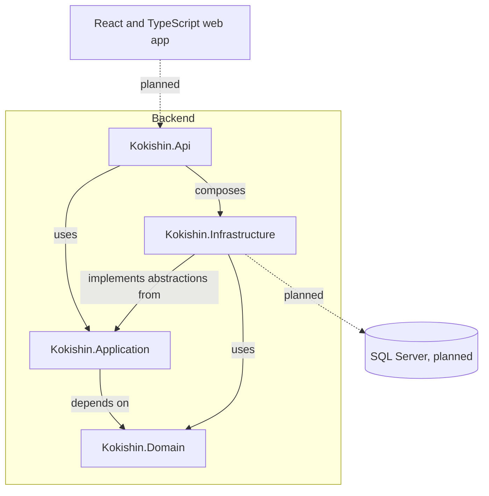

# Component Diagram

The diagram shows the current backend project boundaries and the intended
browser and database integrations. Dashed nodes are planned external
components; no product endpoints or persistence are implemented yet.

## Responsibilities

- **Web app:** displays navigation, course content, forms, submissions, grades, and feedback.
- **API (`backend/src/Kokishin.Api`):** HTTP delivery and composition root. Product endpoints, request validation, and authorization will be added with their features.
- **Application (`backend/src/Kokishin.Application`):** coordinates use cases and owns abstractions required from infrastructure.
- **Domain:** owns core concepts and business rules.
- **Infrastructure (`backend/src/Kokishin.Infrastructure`):** implements application abstractions and handles persistence and other external technical details.
- **Database:** planned durable storage; no provider or schema is part of the current foundation.

The project references enforce the dependency direction: Domain has no project
references; Application references only Domain; Infrastructure references
Application and Domain; API references Application and Infrastructure. The API
composes Infrastructure so application and domain code do not depend on it.
See [Backend structure](../backend/README.md) for the project layout.
