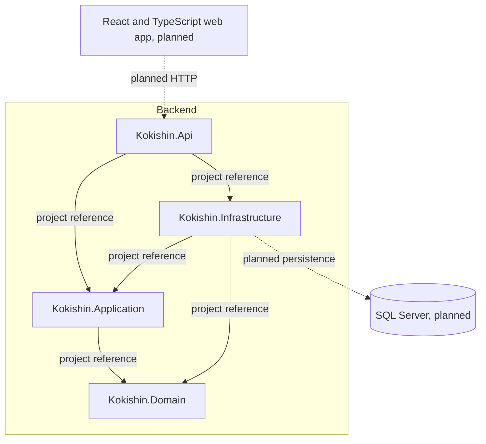

# Component Diagram

Solid arrows show current project references, not runtime calls. Dashed arrows
show planned integrations. The backend projects exist, but product endpoints,
dependency-injection registrations, and persistence are not implemented yet.

## Responsibilities

- **Web app:** displays navigation, course content, forms, submissions, grades, and feedback.
- **API (`backend/src/Kokishin.Api`):** HTTP host and intended composition root. Product endpoints, request validation, authorization, and dependency-injection wiring will be added with their features.
- **Application (`backend/src/Kokishin.Application`):** coordinates use cases and may own abstractions required from infrastructure.
- **Domain:** owns core concepts and business rules.
- **Infrastructure (`backend/src/Kokishin.Infrastructure`):** implements application abstractions and handles persistence and other external technical details.
- **Database:** planned durable storage; no provider or schema is part of the current foundation.

The project references enforce the dependency direction: Domain has no project
references; Application references only Domain; Infrastructure references
Application and Domain; API references Application and Infrastructure. The API
will compose Infrastructure through dependency injection; that runtime wiring
is not implemented yet. Application does not depend on Infrastructure. See
[Backend structure](../backend/README.md) for the project layout.
