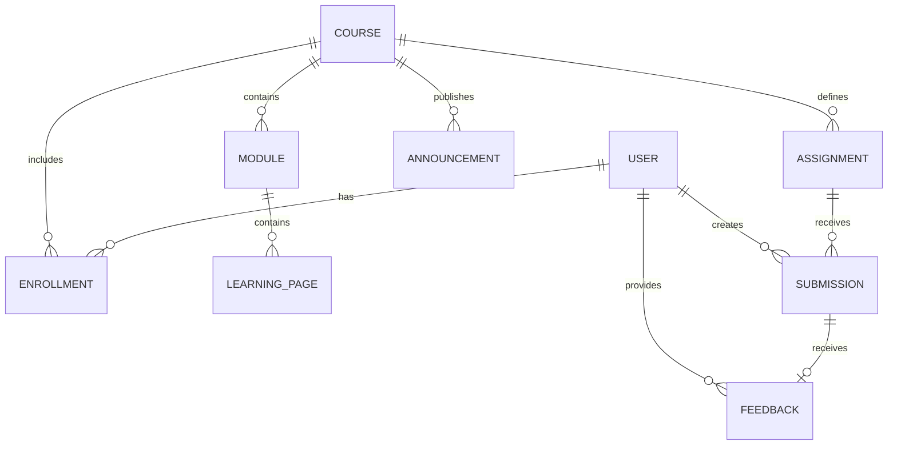

# Data Model

## Initial entities

| Entity | Purpose | Initial relationships |
|---|---|---|
| User | Represents an instructor or learner | Connects to courses through Enrollment |
| Course | Represents a course offering | Contains modules, announcements, and assignments |
| Enrollment | Connects a user to a course and records their role/status | Belongs to User and Course |
| Module | Groups course material into weeks or units | Belongs to Course |
| LearningPage | Stores a page or learning item within a module | Belongs to Module |
| Announcement | Shares course updates | Belongs to Course |
| Assignment | Defines work to be completed | Belongs to Course |
| Submission | Records a learner's submitted work | Belongs to Assignment and User |
| Feedback | Records instructor comments and an optional grade | Relates to a Submission and the instructor who provided it |

## Data-model diagram

## Design considerations

- Every entity will need a stable identifier.
- Creation and modification timestamps should be considered for records that require an audit trail.
- Enrollment and role checks must prevent unauthorized access to course data.
- Grades and feedback must only be visible to authorized users.
- Submission file storage and discussion data need explicit design before those features are implemented.

This document is a conceptual starting point, not a migration-ready schema.
