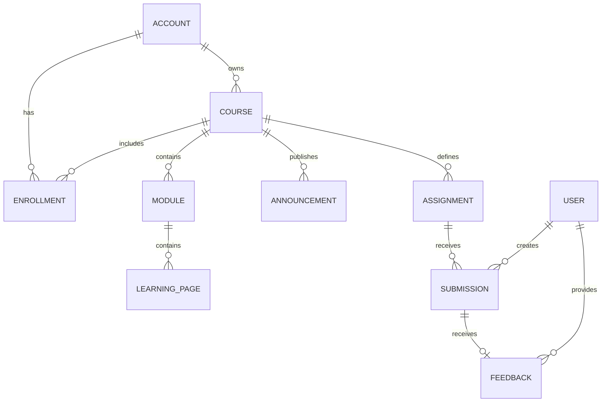

# Data Model

## Entities

| Entity | Purpose | Initial relationships |
|---|---|---|
| Account | Represents an instructor or learner with one global role | Instructors own courses; Learners connect through Enrollment |
| Course | Represents an Instructor-owned course offering; stores a title, optional description, and Draft or Published status | Belongs to its owner; contains modules, announcements, and assignments |
| Enrollment | Connects a Learner account to a course and records membership status | Belongs to Account and Course; unique per course and learner |
| Module | Groups course material into weeks or units | Belongs to Course |
| LearningPage | Stores a page or learning item within a module | Belongs to Module |
| Announcement | Shares course updates | Belongs to Course |
| Assignment | Defines work to be completed | Belongs to Course |
| Submission | Records a learner's submitted work | Belongs to Assignment and User |
| Feedback | Records instructor comments and an optional grade | Relates to a Submission and the instructor who provided it |

## Data-model diagram

## Design considerations

- Only an active Learner account may be enrolled; enrollment does not assign an
  account role. The active course-owning Instructor explicitly creates and
  manages enrollments, with at most one enrollment per account and course.
- Enrollment status is `Active`, `Suspended`, `Withdrawn`, or `Removed`.
  Learners may withdraw their own enrollment; the course owner may suspend,
  reactivate, remove, or re-enroll them. See [AD-008](../decisions/AD-008-course-enrollment.md)
  for transition and duplicate-action rules.
- Learners need an active enrollment and a Published course for content access.
  Draft course content is available only to its owner; changing course status
  does not itself change enrollment status.
- Every entity will need a stable identifier.
- Creation and modification timestamps should be considered for records that require an audit trail.
- Enrollment and role checks must prevent unauthorized access to course data.
- Grades and feedback must only be visible to authorized users.
- Submission file storage and discussion data need explicit design before those features are implemented.

This document is a conceptual starting point, not a migration-ready schema.
Course creation is implemented with a stable ID, an owning account, a required
title, an optional description, and an initial `Draft` status. The remaining
entities and relationships shown here remain conceptual and are not
implemented. Enrollment is persisted with the course ID and learner account
ID as a composite primary key and its status stored as `Active`, `Suspended`,
`Withdrawn`, or `Removed`. Both foreign keys reference existing Courses and
Accounts rows; the composite key enforces one record per course and learner.
