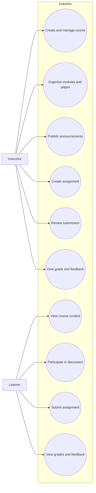

# Use-Case Diagram

The diagram captures the initial MVP use cases. It is a conceptual view, not a finalized implementation specification.

## Notes

- Instructor and learner are the initial primary roles.
- Authentication, enrollment, and authorization support these use cases.
- Additional use cases should be added only when included in an approved scope.
